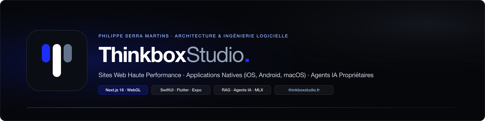

  

  <a href="https://thinkboxstudio.fr"><strong>thinkboxstudio.fr</strong></a> ·
  <a href="https://thinkboxstudio.fr/projets">Réalisations &amp; Marques</a> ·
  <a href="https://thinkboxstudio.fr/services">Expertises</a> ·
  <a href="https://thinkboxstudio.fr/sous-traitance">Sous-traitance Agences</a> ·
  <a href="https://www.linkedin.com/company/89287961/">LinkedIn Studio</a> ·
  <a href="https://www.linkedin.com/in/philippe-serra-martins/">LinkedIn Fondateur</a> ·
  <a href="mailto:contact@thinkboxstudio.fr">contact@thinkboxstudio.fr</a>

---

### Architecture &amp; Ingénierie Logicielle — Marseille · France entière

Fondateur et directeur technique de **[Thinkbox Studio](https://thinkboxstudio.fr)**, je conçois, développe et déploie en direct — sans sous-traitance ni intermédiaire — des plateformes web sur-mesure, des applications mobiles et desktop natives (iOS, Android, macOS) et des systèmes d'intelligence artificielle propriétaires.

- **Web &amp; Expériences 3D Temps Réel** : Next.js 16 (App Router, SSR/ISR), React 19, TypeScript strict, Tailwind CSS v4, Three.js / WebGL / Shaders GLSL, GSAP &amp; Motion.
- **Applications Mobiles &amp; Desktop Natives** : Swift 6, SwiftUI &amp; AppKit (macOS / iOS), Flutter &amp; Dart (architecture modulaire BLoC), React Native &amp; Expo.
- **Systèmes IA &amp; Automatisation Métier** : Agents RAG sur-mesure (recherche hybride vectorielle &amp; lexicale, streaming NDJSON, garde-fous anti-injection), inférence LLM locale sur Apple Silicon (`mlx-swift`), pipelines d'automatisation Python &amp; Node.js.
- **Backend, Données &amp; Infrastructure** : PostgreSQL, Supabase (RLS, Edge Functions), API REST/GraphQL, sécurité Cloudflare Turnstile, déploiement Linux VPS (Nginx, PM2, CI/CD).

---

### Écosystème &amp; Produits Propriétaires en Production

Tous les dépôts de production (clients et marques propres) sont hébergés en **dépôts privés** pour garantir l'exclusivité intellectuelle et la sécurité des architectures déployées.

| Produit / Marque | Domaine | Stack Technique | Statut |
| :--- | :--- | :--- | :--- |
| **[Thinkbox Studio](https://thinkboxstudio.fr)** | Plateforme éditoriale du studio, scènes WebGL &amp; concierge IA **Hélix** (RAG hybride temps réel) | Next.js 16 · TypeScript · Three.js / GLSL · Tailwind v4 · Gemini API | En production |
| **[Omnia](https://omniasport.app)** | Application mobile Sport-Santé inclusive &amp; suivi d'entraînement adaptatif | Flutter · Dart · BLoC · Next.js 16 · Supabase | En production |
| **[Résonance](https://resonancemind.app)** | Application mobile de bien-être mental, respiration guidée &amp; audio spatial | React Native · Expo · TypeScript · Node.js | En production |
| **Tasogare** | Moteur macOS de fonds d'écran cinématiques 5K synchronisés à l'heure et à la météo | Swift · AppKit · Metal / Shaders · Python | En production |
| **Vespair** | Application macOS native &amp; moteur d'inférence LLM local haute performance sur Apple Silicon | Swift 6 · SwiftUI · MLX Swift | En développement actif |
| **Vigie** | Plateforme SaaS d'analyse opérationnelle &amp; tableaux de bord financiers haute lisibilité | Next.js · TypeScript · PostgreSQL / PLpgSQL | En production |

---

### Renfort Technique &amp; Sous-traitance pour Agences Digitales

Vous dirigez une agence digitale, un studio créatif ou une direction produit et cherchez un ingénieur senior capable de livrer un lot complet en marque blanche (intégration créative Next.js/WebGL, application mobile iOS/Android, brique IA RAG) avec un code testé et documenté ?

- Découvrir le dispositif : **[thinkboxstudio.fr/sous-traitance](https://thinkboxstudio.fr/sous-traitance)**
- Échanger en direct : **[contact@thinkboxstudio.fr](mailto:contact@thinkboxstudio.fr)** · **[thinkboxstudio.fr/contact](https://thinkboxstudio.fr/contact)**
